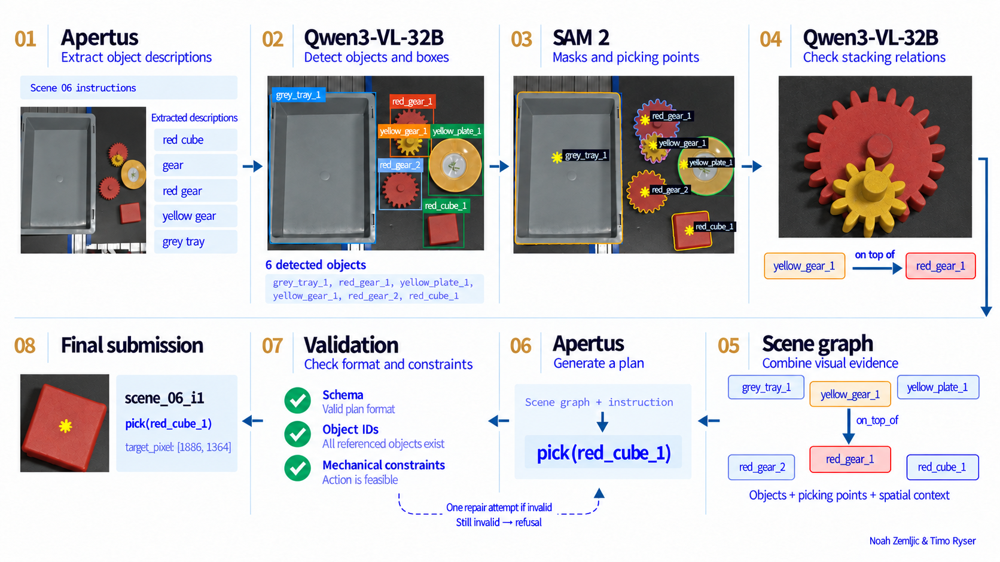

# See It, Say It, Pick It

[](LICENSE)  

A scene-graph approach to language-guided robot planning, built for the Hack Apertus robotics challenge at ZHAW.

**Created by Noah Zemljic and Timo Ryser.**

## About the project

This project is our solution for the **Hack Apertus 2026 robotics challenge at ZHAW: “See It, Say It, Pick It.”** The challenge is to turn a photograph of a robot workcell and an English instruction into a safe, grounded action plan. Apertus must perform the language reasoning, with open vision models helping it interpret the scene. The solution must run locally and work on previously unseen scenes without requiring model training or access to a physical robot.

## Our implementation

For each scene, Apertus reads the instruction and picks out the objects it refers to. Those descriptions guide Qwen3-VL-32B as it searches the image and returns a box for each visible object. SAM 2 then segments the boxed objects, giving us masks from which we calculate a safe picking point and measure their positions in the scene.

We use Qwen3-VL-32B once more to look at how the identified objects sit on one another. Combining those observations with the masks and geometric measurements gives us a scene graph: a shared account of what is in the image and how the objects relate. Apertus uses both that graph and the original instruction to decide what the robot should do.

Before saving the answer, we check that it follows the required format and respects the scene’s mechanical constraints, including which objects are reachable and whether another object blocks the pick. If a plan fails validation, Apertus gets one chance to correct it; an answer that still fails becomes a refusal. The final JSON contains the ordered actions and the pixel of the first object to pick. The container launcher stops the model servers after planning, then runs the evaluator when ground truth is available.

The diagram below illustrates the pipeline implementation:



## Infrastructure and configuration

We run the project on **Clariden**, part of the Alps research infrastructure at the Swiss National Supercomputing Centre (CSCS). Clariden is the main GPU cluster of the [CSCS Machine Learning Platform](https://docs.cscs.ch/platforms/mlp/), which provides the compute and storage needed for workloads such as large-model inference and training. Its [Grace-Hopper nodes](https://docs.cscs.ch/alps/hardware/) each contain four NVIDIA GH200 superchips, pairing ARM-based Grace CPUs with Hopper GPUs.

For this project, we use one complete node for inference with pretrained models. Apertus spans two GPUs through tensor parallelism, while Qwen and SAM each have a dedicated GPU. This lets the language and vision models stay loaded throughout the run, with all requests handled by local services inside the same container. The allocation is:

| Component                     | Model                 | GPU allocation |
| ----------------------------- | --------------------- | -------------- |
| Language reasoning            | Apertus v1.5 70B      | GPUs 0 and 1   |
| Object detection and stacking | Qwen3-VL-32B-Instruct | GPU 2          |
| Segmentation                  | SAM 2.1 Hiera Small   | GPU 3          |

Slurm schedules the node, and the CSCS Container Engine loads our image through an environment definition file (EDF). The [batch job](containers/clariden.sbatch) requests the **normal partition**, one node, four GPUs, 64 CPUs and 90 minutes. Inside the container, the launcher starts the Apertus and Qwen vLLM servers, runs perception and planning, and shuts down the servers before evaluating the saved submission. Model weights are downloaded once during setup; subsequent runs use the local cache offline.

The configuration is split between [containers/deployment.toml](containers/deployment.toml), which defines models and GPU assignments, and [containers/clariden.edf.toml](containers/clariden.edf.toml), which defines the image, mounts and cache paths. The checkout and run outputs live under `$HOME/hack-apertus`, while the reusable model cache lives under `$SCRATCH/hack-apertus`.

## Getting started on Clariden

### Prerequisites

Before starting, make sure you have:

- **Access to Clariden**, with a CSCS account, a working SSH connection and a Slurm project allocation that can request a node with four GPUs.
- **Git and access to this repository** on your build host and on Clariden.
- **A Hugging Face account with access to the Apertus model.** Accept the model’s access conditions before downloading its weights.
- **An ARM64 Linux build environment with Podman and Enroot.** You can build on a Clariden compute node using the node-local storage setup in step 2, or use a separate ARM64 host.
- **Storage for the container, model weights and run outputs.** The reusable model cache lives under `$SCRATCH/hack-apertus`; the checkout and outputs live under `$HOME/hack-apertus`.

Building the container and downloading the 70B and 32B model checkpoints are one-time setup tasks.

### 1. Clone the repository

On your build host, clone the project into your home directory:

```bash
cd "$HOME"
git clone https://github.com/NoahZemljic/hack-apertus.git
cd hack-apertus
```

Keep the same checkout at `$HOME/hack-apertus` on Clariden. If you use another location, update the dataset path in `containers/clariden.edf.toml` and the paths in the commands below.

### 2. Build and import the container

Build on an ARM64 Linux host with local Podman storage. Clariden’s shared home and scratch filesystems do not support the extended attributes needed for its image layers. If building directly on Clariden, open a build allocation from the login node and configure node-local storage:

```bash
srun -A <project_account> --partition=normal \
  --nodes=1 --ntasks=1 --cpus-per-task=32 --time=01:00:00 --pty bash
cd "$HOME/hack-apertus"
build_storage="$(mktemp -d /tmp/hack-apertus-build-XXXXXX)"
export CONTAINERS_STORAGE_CONF="$build_storage/storage.conf"
cat > "$CONTAINERS_STORAGE_CONF" <<EOF
[storage]
driver = "overlay"
graphroot = "$build_storage/storage"
runroot = "$build_storage/run"
[storage.options.overlay]
mount_program = "/usr/bin/fuse-overlayfs"
EOF
```

Build and import in the same allocation so that Podman’s node-local storage stays available. On another ARM64 build host, use its local Podman storage and start here:

```bash
podman build --platform linux/arm64 \
  -f containers/Containerfile -t hack-apertus:latest .
```

The Containerfile pins the Swiss AI release image and adds the application dependencies. It also runs environment and model-import checks. Keep the release’s Torch, Transformers and vLLM packages together, since Apertus depends on that engine build.

On a host with Enroot and access to the built Podman image, convert it to the SquashFS image used by Clariden. The scoped function handles a Docker-specific cleanup call in Clariden’s Enroot Podman importer:

```bash
mkdir -p "$SCRATCH/hack-apertus/containers"
(
  docker() { (cd / && podman "$@" --ignore); }
  export -f docker
  enroot import \
    -o "$SCRATCH/hack-apertus/containers/pipeline-arm64.sqsh" \
    podman://hack-apertus:latest
)
```

If you used a build allocation, leave it with `exit` after the import completes. If you build elsewhere, copy the resulting `.sqsh` file to that path on Clariden. Docker can also build the Containerfile; for a Docker image, use a plain `enroot import` command with `dockerd://hack-apertus:latest`. See the [Enroot documentation](https://github.com/NVIDIA/enroot/blob/main/doc/cmd/import.md) for import options.

### 3. Open the container and download the models

From `$HOME/hack-apertus` on a Clariden login node, request an interactive session. Replace `<project_account>` with your Slurm allocation:

```bash
srun -A <project_account> --partition=normal \
  --nodes=1 --ntasks=1 --gpus-per-node=4 --cpus-per-task=64 \
  --time=01:30:00 --environment=./containers/clariden.edf.toml --pty bash
```

The following commands run **inside that container**. Authenticate with Hugging Face and prepare the persistent model cache:

```bash
cd "$HOME/hack-apertus"
hf auth login
bash containers/start_pipeline.sh --prepare-cache --
```

This downloads Apertus, Qwen and SAM into the `HF_HOME` directory configured by the environment file. The cache can be reused across jobs, so this download is only needed again if the cached weights are removed or updated.

### 4. Run the project

With the cache ready, this single command runs the public dataset from perception through planning and evaluation:

```bash
bash containers/start_pipeline.sh -- \
  --data "$HOME/hack-apertus/dataset" \
  --out "$HOME/hack-apertus/outputs/final/results.json"
```

For the held-out dataset, run:

```bash
bash containers/start_pipeline.sh -- \
  --data "$HOME/hack-apertus/heldout" \
  --out "$HOME/hack-apertus/outputs/heldout/results_heldout.json"
```

The launcher starts both model servers, waits for them to become ready, and runs the planning pipeline. When the pipeline exits successfully, it stops the servers and runs the official evaluator as the container’s final step. You do not need to score the results separately. Use a fresh output directory for each run to keep its artifacts together.

For an unattended run, leave the interactive session with `exit` and submit the same work from the login node:

```bash
cd "$HOME/hack-apertus"
sbatch -A <project_account> containers/clariden.sbatch -- \
  --data "$HOME/hack-apertus/dataset" \
  --out "$HOME/hack-apertus/outputs/final/results.json"
```

For an unattended held-out run:

```bash
sbatch -A <project_account> containers/clariden.sbatch -- \
  --data "$HOME/hack-apertus/heldout" \
  --out "$HOME/hack-apertus/outputs/heldout/results_heldout.json"
```

`sbatch` returns a job ID immediately. Follow the job in `hack-apertus-<job_id>.log`; submission alone does not mean the run has finished.

Any input folder should contain scene subfolders with `rgb.png` and `instructions.txt`, plus `calibration.json` either in each scene or at the dataset root. Depth data can also be loaded when available. [starter/scene_io.py](starter/scene_io.py) describes the loading conventions.

### 5. View the results

| Output                                           | What to use it for                                           |
| ------------------------------------------------ | ------------------------------------------------------------ |
| `results.json`                                   | The final submission: one answer per instruction             |
| `report.json`                                    | Evaluation score and per-instruction results                 |
| `evaluation.json`                                | Whether evaluation completed, failed or was skipped          |
| `scene_graphs/`                                  | Scene graphs, spatial context and image overlays             |
| `geometry_results.json` and perception artifacts | Boxes, masks, picking points and support relations           |
| `results.raw.jsonl`                              | Apertus requests, replies and validation errors              |
| `run_manifest.json` and `planning_policy.txt`    | Source hashes, run settings and the planning prompt snapshot |
| `deployment_logs/`                               | Model logs, pipeline progress, GPU usage and timing          |

For the public dataset, evaluation produces the automatic score out of 65; the remaining 35 points are assessed by the jury. See [starter/evaluate.py](starter/evaluate.py) for the scoring rules. Held-out data has no public answers, so the launcher records evaluation as skipped and leaves the submission ready for organizer scoring. If annotations exist but evaluation fails, the launcher returns an error. Scoring output appears in the container console or Slurm job log; planning progress appears in `deployment_logs/<run>/pipeline.log`.

A failed perception stage or model connection stops the run, preserving any checkpointed results without scoring them as a completed submission. Plans that fail validation become logged refusals and remain part of the evaluated submission. For debugging, `--scene scene_06` selects one scene and `--limit 1` selects one instruction. The official evaluator still scores against the whole annotated dataset, so those partial runs are only setup checks. `--build-only` stops after graph creation and skips evaluation.

## Using another machine

On another ARM64 Linux machine with four suitable NVIDIA GPUs, Docker and NVIDIA container support, build the same image and open a shell with persistent cache and output mounts:

```bash
mkdir -p .cache/huggingface "$HOME/hack-apertus/outputs"
docker run --rm -it --gpus all --ipc=host \
  -v "$PWD:/opt/hack-apertus" \
  -v "$PWD/.cache/huggingface:/cache/huggingface" \
  -v "$HOME/hack-apertus/outputs:/outputs" \
  -e HACK_APERTUS_OUTPUT=/outputs \
  -e HF_HOME=/cache/huggingface \
  --entrypoint bash hack-apertus:latest
```

Inside this shell, run `hf auth login` and the cache-preparation command from step 3. Then run:

```bash
bash containers/start_pipeline.sh -- \
  --data dataset --out /outputs/final/results.json
```

The output mount keeps the results under `$HOME/hack-apertus/outputs` on your host. For planning replay with saved geometry, see [instructions.md](instructions.md).

## Checking the setup without GPUs

With Python 3.11–3.13 and `uv` installed, you can run the data tools, evaluator and environment checks on a laptop:

```bash
uv sync
source .venv/bin/activate
python starter/evaluate.py examples/example_results.json --data dataset
python -m src.check_environment --profile base
bash containers/start_pipeline.sh --dry-run -- --data dataset
```

These checks do not load the models. The example submission contains five answers, so the evaluator counts the other dataset instructions as missing. Running `python run_grounded.py` directly generates plans only; automatic evaluation is handled by the container launcher.

## License

Code is licensed under the [Apache License 2.0](LICENSE). Data in `dataset/` is licensed under [CC BY 4.0](https://creativecommons.org/licenses/by/4.0/), as specified by the [original challenge repository](https://github.com/Fatemeh-MA/see-it-say-it-pick-it).
